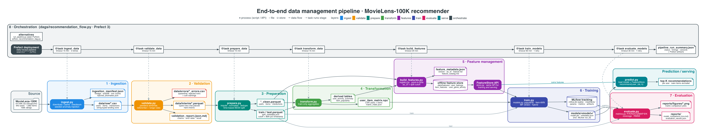

# Pipeline Architecture



*Rendered by `scripts/make_architecture_diagram.py` (`make diagram`) to
`reports/figures/architecture.{png,svg}`. The Mermaid diagram below shows the same flow and
renders directly on GitHub/GitLab.*

The pipeline is a **layered data lake + stage DAG**. Each stage is a module with
`run(cfg) -> dict`; stages communicate **only through files** (contracts in
[`data_contracts.md`](data_contracts.md)), so any stage can be re-run, tested or debugged on its
own. The orchestration layer adds scheduling, dependency ordering, retries, timeouts,
observability and a run record, but no business logic.

```mermaid
flowchart LR
    src[("MovieLens-100K<br/>ml-100k.zip · GroupLens")]

    subgraph S1["1 · Ingestion"]
        ingest["ingest.py<br/>download/cache · checksum · anomaly injection"]
        raw[/"data/raw/*.csv<br/>string-typed landing"/]
        manifest[/"ingestion_manifest.json<br/>injected_anomalies.json"/]
    end
    subgraph S2["2 · Validation"]
        validate["validate.py<br/>pandera schemas · quality rules"]
        interim[/"data/interim/*.parquet<br/>typed, passed hard checks"/]
        errors[/"data/errors/*_errors.csv<br/>quarantine"/]
        vreport[/"validation_report.{json,md}"/]
    end
    subgraph S3["3 · Preparation"]
        prepare["prepare.py<br/>impute · normalise · dedupe · time split"]
        clean[/"*_clean.parquet"/]
        split[/"train.parquet / test.parquet<br/>split_metadata.json"/]
    end
    subgraph S4["4 · Transformation"]
        transform["transform.py<br/>train-only aggregates"]
        derived[/"user_activity_summary<br/>item_popularity"/]
        matrix[/"user_item_matrix.npz<br/>matrix_index.json"/]
    end
    subgraph S5["5 · Feature management"]
        features["build_features.py + registry.py<br/>point-in-time (as_of = cutoff)"]
        fstore[("offline feature store<br/>data/features/*.parquet")]
        fmeta[/"feature_metadata.json<br/>feature_catalog.md"/]
        fsapi{{"FeatureStore API (store.py)"}}
    end
    subgraph S6["6 · Training"]
        train["train.py + models.py<br/>popularity · item-kNN · MF · hybrid"]
        models[/"models/{model}/model.pkl<br/>metadata.json (MLflow run_id)"/]
        mlflow[("MLflow tracking<br/>mlflow.db (sqlite) + mlartifacts/")]
    end
    subgraph S7["7 · Evaluation"]
        evaluate["evaluate.py + metrics.py<br/>ranking + rating metrics"]
        ereports[/"model_comparison.{csv,md}<br/>evaluation_results.json · figures"/]
    end
    subgraph SV["Prediction / serving"]
        predict["predict.py<br/>recommend(user_ids, k)"]
        topk[/"top-K recommendations"/]
    end
    subgraph S8["8 · Orchestration (Prefect 3 · dags/recommendation_flow.py)"]
        direction LR
        sched(["deployment daily-recsys-pipeline<br/>cron 0 2 * * *"])
        t1["ingest_data"] --> t2["validate_data"] --> t3["prepare_data"] --> t4["transform_data"]
        t4 --> t5["build_features"] --> t6["train_models"] --> t7["evaluate_models"]
        summary[/"pipeline_run_summary.json<br/>+ Prefect artifacts"/]
        sched --> t1
        t7 --> summary
    end

    src --> ingest --> raw & manifest
    raw --> validate --> interim & errors & vreport
    interim --> prepare --> clean & split
    clean & split --> transform --> derived & matrix
    clean & derived --> features --> fstore & fmeta
    fstore --> fsapi
    fsapi & matrix --> train
    split -- train --> train
    train --> models & mlflow
    models --> evaluate
    split -- test --> evaluate
    evaluate --> ereports
    evaluate -. metrics .-> mlflow
    models & fsapi --> predict --> topk

    t1 -.-> ingest
    t2 -.-> validate
    t3 -.-> prepare
    t4 -.-> transform
    t5 -.-> features
    t6 -.-> train
    t7 -.-> evaluate

    classDef c_ingestion fill:#1E88E5,color:#fff,stroke:#1E88E5
    classDef c_validation fill:#F09300,color:#fff,stroke:#F09300
    classDef c_preparation fill:#00897B,color:#fff,stroke:#00897B
    classDef c_transformation fill:#43A047,color:#fff,stroke:#43A047
    classDef c_features fill:#8E24AA,color:#fff,stroke:#8E24AA
    classDef c_training fill:#3949AB,color:#fff,stroke:#3949AB
    classDef c_evaluation fill:#D81B60,color:#fff,stroke:#D81B60
    classDef c_serving fill:#00838F,color:#fff,stroke:#00838F
    classDef c_orchestration fill:#37474F,color:#fff,stroke:#37474F
    classDef c_quarantine fill:#fff,stroke:#E53935,stroke-width:2px
    class ingest c_ingestion
    class validate c_validation
    class prepare c_preparation
    class transform c_transformation
    class features,fsapi c_features
    class train c_training
    class evaluate c_evaluation
    class predict c_serving
    class sched c_orchestration
    class errors c_quarantine
```



## Layers

| # | Layer | Module(s) | Responsibility | Writes |
|---|-------|-----------|----------------|--------|
| – | Source | – | Public MovieLens-100K archive from GroupLens (943 users, 1,682 movies, 100k ratings). | – |
| 1 | Ingestion | `src/ingestion/ingest.py` | Download the archive (or reuse the cached copy), extract it safely, convert the three source files into **string-typed** CSV landing files (so validation sees the data exactly as received), inject a seeded, documented set of data-quality anomalies, record lineage (URL, sha256, row counts, timestamp). | `data/raw/` |
| 2 | Validation | `src/validation/validate.py` | Pandera schemas plus referential/range/type rules. Rows with hard errors and exact duplicates are **quarantined** in `data/errors/`; soft (attribute-level) problems are nulled and logged as warnings. Quality gate: the run fails if the rejected-interaction rate exceeds `validation.max_error_rate`. | `data/interim/`, `data/errors/`, `reports/validation_report.*` |
| 3 | Preparation | `src/preparation/prepare.py` | Impute and normalise attributes, resolve duplicate (user, item) pairs (latest kept), and split **globally by time** (80th-percentile timestamp cutoff) so the test set is strictly in the future of the training set. | `data/processed/*_clean`, `train`, `test`, `split_metadata.json` |
| 4 | Transformation | `src/transformation/transform.py` | Derived datasets computed **on train only** (no leakage): per-user activity, per-item popularity with a Bayesian-damped mean, and the sparse CSR user–item matrix with its index. | `data/processed/` |
| 5 | Feature management | `src/features/` | Point-in-time features (`as_of` = split cutoff) materialised in an offline feature store with a versioned registry, metadata and a feature catalogue. `FeatureStore` is the single access API used by **both** training and prediction, preventing training/serving skew. | `data/features/`, `reports/feature_catalog.md` |
| 6 | Training | `src/training/` | Common model interface; popularity baseline, item-item kNN, biased matrix factorisation (SGD) and a hybrid (MF + genre affinity). Parameters, metrics and artefacts are tracked in **MLflow** (`sqlite:///mlflow.db`, artefacts in `mlartifacts/`); each model's `metadata.json` stores its MLflow `run_id`. | `models/`, MLflow |
| 7 | Evaluation | `src/evaluation/` | Ranking and rating metrics on the time-based test split; comparison table, plots and metrics logged back to MLflow. | `reports/` |
| – | Prediction | `src/training/predict.py` | Loads a trained model and the same `FeatureStore` to produce top-K recommendations (with explanation features) for a user; cold users get the popularity fallback. | stdout |
| 8 | Orchestration | `dags/`, `run_pipeline.py` | Dependency ordering, scheduling, retries, timeouts, artifacts and a run record (details below). | `reports/pipeline_run_summary.json` |

## Orchestration design

**Single source of truth.** `dags/pipeline_spec.py` declares the stage DAG once: module entry point,
upstream stages (following the *data lineage* in the contracts, e.g. `features ← preparation,
transformation`), timeout and retry policy. Every orchestrator is a thin adapter over this spec, so
the Prefect flow, the Airflow DAG and the plain-Python runner cannot drift apart. Stage modules are
imported lazily, so the orchestration layer can be imported, listed and tested on its own.

| Task (Prefect / Airflow) | Stage module | Upstream | Timeout | Retries |
|---|---|---|---|---|
| `ingest_data` | `src.ingestion.ingest` | – | 15 min | 3, exponential back-off from 10 s (network I/O) |
| `validate_data` | `src.validation.validate` | ingestion | 15 min | 0 |
| `prepare_data` | `src.preparation.prepare` | validation | 15 min | 0 |
| `transform_data` | `src.transformation.transform` | preparation | 15 min | 0 |
| `build_features` | `src.features.build_features` | preparation, transformation | 20 min | 0 |
| `train_models` | `src.training.train` | preparation, features | 60 min | 1 after 30 s (MLflow sqlite locking) |
| `evaluate_models` | `src.evaluation.evaluate` | preparation, training | 30 min | 1 after 30 s |

Deterministic stages are not retried: a retry would fail identically and only hide the error.

**Prefect 3 flow** – `dags/recommendation_flow.py`, flow `recommendation_pipeline(config_path=None,
skip_ingestion=False)`:

* one `@task` per stage; upstream task states are passed through `wait_for`, so the Prefect UI
  shows the lineage graph; caching is disabled (`NO_CACHE`) because stages have file side effects;
* task-level logging via `get_run_logger()` (stage start, module, returned summary);
* fail-fast: the first failed stage stops the run, downstream stages are recorded as `skipped`,
  the run summary is still written and the flow run ends `Failed`;
* artifacts: `validation-summary` (table: status, row counts, quality and post-condition gates,
  anomaly-detection recall), `validation-report` (the full markdown report), `model-comparison`
  (table from `reports/model_comparison.csv`) and `pipeline-run-summary` (markdown: per-stage
  status and duration + model comparison);
* scheduling: `python dags/recommendation_flow.py --serve` registers and serves the deployment
  `daily-recsys-pipeline` with cron `0 2 * * *` (02:00 UTC).

Without a running server Prefect starts a temporary local API for the duration of the run. To
browse runs, task graphs and artifacts: `make prefect-ui` (binds `127.0.0.1:4200`), then
`export PREFECT_API_URL=http://127.0.0.1:4200/api` before `make flow`.

**Alternatives.** `run_pipeline.py` is a dependency-free runner (topological execution,
`--stages`, `--from-stage`, `--config`, `--list`, fail-fast, exit code 1 on failure) that writes the
same run summary. `dags/airflow_recommendation_dag.py` is the equivalent Airflow DAG (a
`PythonOperator` per stage, same edges, retries and timeouts, daily schedule, `catchup=False`) for
teams standardised on Airflow; Airflow is not a project dependency.

**Run record** – `reports/pipeline_run_summary.json`:

```json
{
  "pipeline": "recommendation-pipeline", "orchestrator": "prefect | run_pipeline",
  "flow_run_id": "<uuid or null>", "status": "success | failed", "failed_stage": null,
  "started_at_utc": "...", "finished_at_utc": "...", "duration_sec": 0.0,
  "stages": [{"name": "ingestion", "task_name": "ingest_data", "upstream": [], "status": "success",
              "started_at_utc": "...", "finished_at_utc": "...", "duration_sec": 0.19,
              "summary": {"...": "dict returned by the stage's run()"}, "error": null}],
  "reproducibility": {"seed": 42, "config_path": "...", "config_sha256": "...", "git_commit": "...",
                      "python": "3.11.13", "platform": "...", "packages": {"pandas": "2.2.3", "...": "..."}}
}
```

## Reproducibility

* **One config** (`configs/config.yaml`, or `--config` / `$RECSYS_CONFIG`); all paths are resolved
  from it, nothing is hard-coded. Its sha256 is stored in every run summary.
* **Fixed seeds**: `project.seed` (models, sampling) and `ingestion.anomaly_seed`; orchestrators
  also seed Python's and NumPy's global RNGs before running stages.
* **Deterministic data**: checksummed source archive, seeded anomaly injection, a global time-based
  split and train-only derived data/features.
* **Pinned environment**: `requirements.txt` (patch-level ranges, Python 3.11; `make setup`),
  `make lock` freezes the exact resolved set to `requirements.lock`, and package versions are
  recorded per run.
* **Lineage**: ingestion manifest → validation report → split metadata → feature metadata → model
  metadata (MLflow `run_id`) → evaluation results → run summary.
* **One-command runs**: `make pipeline` (plain Python) or `make flow` (Prefect); single stages via
  `make ingest | validate | prepare | transform | features | train | evaluate`; `make test`;
  `make clean` removes all generated data, models and reports but never `data/raw/source`.

Local UIs (`make mlflow-ui`, `make prefect-ui`) bind to `127.0.0.1` only; to view them from
another machine, use an SSH port-forward rather than binding to a public interface.
