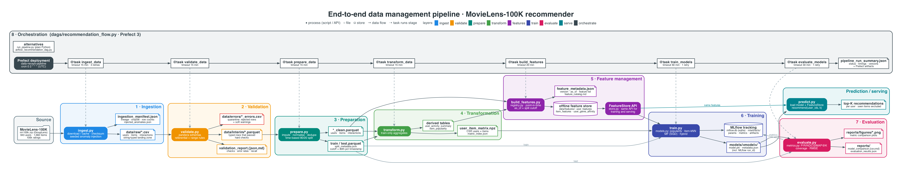
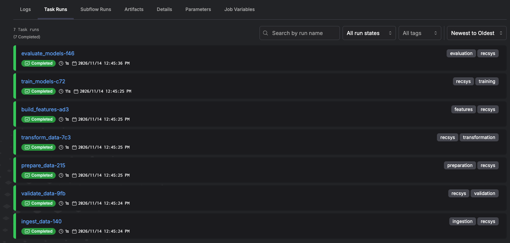
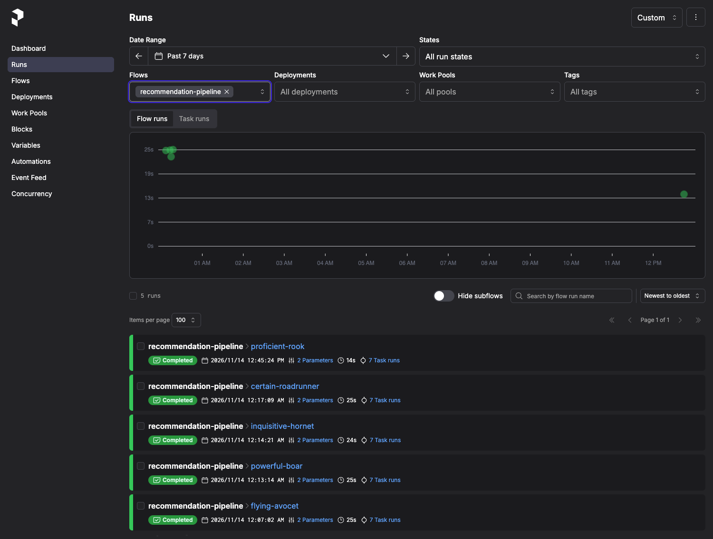
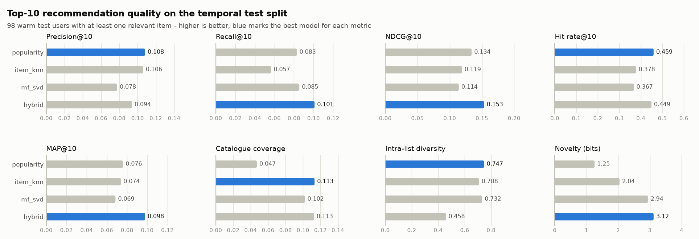
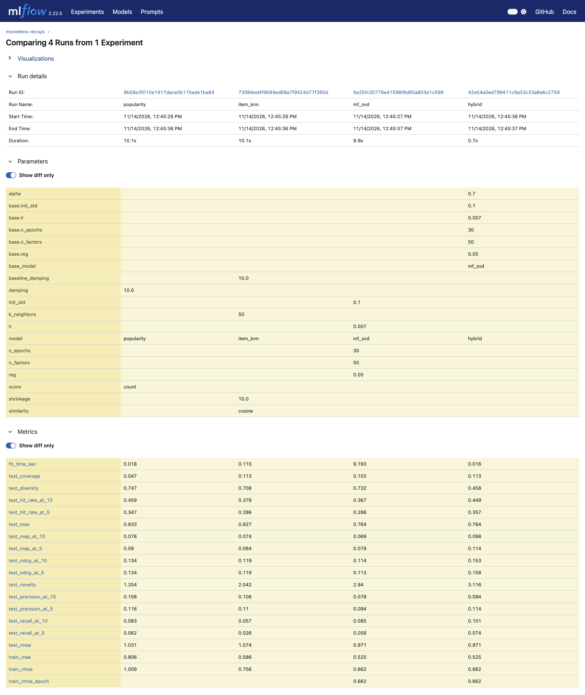

# End-to-End Data Management Pipeline for a Recommendation System

**Data Management for Machine Learning – Assignment 2 · Final report**

Name: B. Somugi Priya · Student ID: 2025AG05455 · Repository: [github.com/2025ag05455-web/2025AG05455-DMML-Assignment2](https://github.com/2025ag05455-web/2025AG05455-DMML-Assignment2) · 14 November 2026

## 1. Objective and dataset

The goal is a clean, modular and reproducible pipeline that takes raw user, item and interaction data
through ingestion, validation, preparation, transformation, feature management, model training,
evaluation and orchestration, and produces top-K movie recommendations.

The data is **MovieLens-100K** (GroupLens): 943 users with demographics, 1,682 movies with genres and
release dates, and 100,000 explicit 1–5 ratings from Sep 1997 to Apr 1998. It was chosen because it
is public, contains all three required entity types, has explicit ratings (so both ranking and
rating metrics apply) and has timestamps (so a realistic time-based split is possible). Its licence
forbids redistribution, so the pipeline downloads and checksums the archive itself and the
repository contains code only. Because MovieLens is already clean, ingestion injects **90 seeded,
documented data-quality anomalies** so that the validation layer is genuinely exercised.

## 2. Architecture and design decisions

The full diagram is in Appendix Figure A1. Each of the eight stages is a module exposing
`run(cfg) -> dict`, and stages communicate **only through files** in a layered data lake:
`data/raw` (string-typed landing) → `data/interim` (validated, typed) → `data/processed` (cleaned,
split, derived) → `data/features` (offline feature store), with `data/errors` as quarantine. The file
contracts are documented in `docs/data_contracts.md`.

| Decision | Rationale |
|---|---|
| File contracts between stages | Any stage can be re-run, tested or debugged in isolation; a failure never corrupts upstream data. |
| One DAG spec (`dags/pipeline_spec.py`) | The Prefect flow, the Airflow DAG and the plain-Python runner are thin adapters over the same task list, so they cannot drift apart. |
| One config (`configs/config.yaml`) | No hard-coded paths or hyperparameters; its SHA-256 is recorded in every run summary and MLflow run. |
| Leakage prevention | Global time-based split; every aggregate, feature and the interaction matrix is computed on the training period only (point-in-time `as_of` = split cutoff). |
| Fail-fast quality gates | Validation stops the run if the interaction error rate exceeds 5 % or an output breaks its schema, instead of training on bad data. |
| Parquet for typed data | Interim, processed and feature data keep their schema and are compact; CSV is kept for raw landing and human-readable error files. |

## 3. Data ingestion and validation

**Ingestion** downloads (or reuses the cached) `ml-100k.zip`, verifies its SHA-256, extracts it safely,
writes `users`, `items` and `interactions` CSVs as strings so validation sees the data exactly as
received, injects the anomalies with a fixed seed, and records lineage in `ingestion_manifest.json`
(URL, checksum, row counts, time) plus the ground truth in `injected_anomalies.json`.

**Validation** combines Pandera schemas with vectorised custom checks: required columns, null
tokens, exact duplicates, missing values, data types, allowed ratings {1..5}, age 5–100, gender M/F,
timestamps inside 1995–2000, primary-key uniqueness, and **referential integrity** of interactions
against the *validated* users and items. Hard errors quarantine the row to
`data/errors/<entity>_errors.csv` with the error type, column and detail; soft attribute problems
null the value, log a warning and leave it for imputation. A post-condition gate re-checks every
output against a strict contract schema and exact dtypes.

| Entity | Input rows | Rejected (quarantined) | Rows with warnings | Output rows |
|---|---:|---:|---:|---:|
| users | 946 | 3 | 10 | 943 |
| items | 1,684 | 2 | 7 | 1,682 |
| interactions | 100,071 | 71 | 0 | 100,000 |

All **90 of 90 injected anomalies were detected (100 % recall)**. Validation also surfaced 4
pre-existing source issues (3 missing IMDb URLs, 1 missing release date), and the output row counts
equal the original dataset exactly, so no valid record was lost. The interaction hard-error rate was
0.071 %, well below the 5 % gate. Full report: `reports/validation_report.md`.

## 4. Data preparation and transformation

**Preparation** imputes missing ages with the median (8 users), maps invalid genders to `unknown` (2),
recovers missing titles and release years (from the release date, else from the title), normalises
categorical text, resolves duplicate (user, item) pairs by keeping the latest rating, and drops
orphans. It then performs a **global time-based split** at the 80th-percentile timestamp
(1998-03-07 02:21 UTC): 80,003 training and 19,997 test ratings, with every test rating strictly
later than every training rating. As in a real deployment, 192 of the 301 test users have no
history before the cutoff; they are kept and evaluated separately as a cold-start slice.

**Transformation** builds the derived datasets from the training period only:
`user_activity_summary` (count, mean, std, first/last activity, active days), `item_popularity`
(count, mean, Bayesian-damped mean, rank, percentile), `genre_popularity`, and a sparse CSR
**user–item interaction matrix** (943 × 1,682) with its id index.

## 5. Feature management

Instead of Feast, a lightweight custom feature layer is used. A registry (`src/features/registry.py`)
declares each feature's entity, dtype, description, computation logic, point-in-time flag and
consumers. `build_features.py` materialises an offline store (`user_features` 943 × 16,
`item_features` 1,682 × 32, `user_genre_affinity` 943 × 22), writes versioned metadata (`v1`,
`as_of` = split cutoff) and auto-generates the **feature catalog** table (`reports/feature_catalog.md`,
28 definitions). Examples are `user_n_ratings`, `user_avg_rating`, `user_days_since_last_interaction`,
`user_preferred_genre`, `user_genre_entropy`, `item_n_ratings`, `item_bayesian_avg_rating`,
`item_popularity_rank` and the on-demand `user_item_genre_affinity` (cosine of the user's genre
shares and the item's genre flags). Training **and** prediction (`src/training/predict.py`) read
features only through the same `FeatureStore` API, which prevents training/serving skew.

## 6. Model training and experiment tracking

All models share one interface (`fit`, `recommend`, `predict`, `save`/`load`); users with no
training history fall back to the popularity model.

| Model | Type | Method and key hyperparameters |
|---|---|---|
| `popularity` | Baseline | Most-rated unseen items; rating prediction = damped item mean (damping 10) |
| `item_knn` | Collaborative (memory-based) | Item–item adjusted cosine, k = 50 neighbours, shrinkage 10 |
| `mf_svd` | Matrix factorisation | Biased MF with SGD: 50 factors, 30 epochs, lr 0.007, L2 0.05 |
| `hybrid` | Hybrid | 0.7 × per-user min-max MF score + 0.3 × genre affinity from the feature store |

Every training run is tracked in **MLflow** (SQLite backend, experiment `movielens-recsys`):
hyperparameters, data-lineage parameters (training-data SHA-256, split cutoff, feature-set version,
config SHA-256), metrics (per-epoch training RMSE and all test metrics) and artifacts (`model.pkl`,
metadata, config, evaluation metrics, sample recommendations). Each model's `metadata.json` stores
its MLflow `run_id`, linking the files on disk to the tracked run (Appendix Figures A2 and A7).

## 7. Model evaluation

Protocol: a test rating ≥ 4 counts as relevant; for each warm user (98 users with training history
and at least one relevant test item), the 1,616 training items not already rated are ranked.
Coverage is the share of the catalogue recommended to at least one user; diversity is
1 − mean pairwise genre cosine similarity within a list; RMSE/MAE use the 2,949 warm-user test ratings.

| Model | Precision@10 | Recall@10 | NDCG@10 | Coverage | Diversity | Novelty | RMSE | MAE |
|---|---:|---:|---:|---:|---:|---:|---:|---:|
| popularity | **0.108** | 0.083 | 0.134 | 0.047 | **0.747** | 1.25 | 1.031 | 0.833 |
| item_knn | 0.106 | 0.057 | 0.119 | **0.113** | 0.708 | 2.04 | 1.074 | 0.827 |
| mf_svd | 0.078 | 0.086 | 0.114 | 0.102 | 0.732 | 2.94 | **0.971** | **0.764** |
| hybrid | 0.094 | **0.101** | **0.153** | **0.113** | 0.458 | **3.12** | **0.971** | **0.764** |

* **Hybrid is the best model on the primary metric**: NDCG@10 is 0.153 (+14 % over the popularity
  baseline), recall@10 is +22 % and MAP@10 is the highest (0.098). Combining the collaborative score
  with genre content gives the best-ordered lists.
* **The popularity baseline is strong** on precision@10 and hit rate. This is expected on MovieLens
  with a temporal split, because films that become popular in the test period dominate the relevant
  items. It is the reason a baseline is mandatory.
* **Rating accuracy**: MF (whose ratings the hybrid reuses) lowers RMSE from 1.031 to 0.971 (−6 %)
  and MAE from 0.833 to 0.764.
* **Beyond accuracy**: the personalised models cover 2.2–2.4× more of the catalogue and recommend
  far less obvious items (novelty 2.0–3.1 vs 1.25 bits). The trade-off is that the hybrid's genre
  term narrows each list (diversity 0.46 vs 0.75).
* **Cold-start slice**: all 192 cold users receive the popularity fallback (NDCG@10 = 0.315 for every
  model). Full tables at K = 5 and 10: `reports/model_comparison.md`.

## 8. Orchestration and reproducibility

The workflow is a **Prefect 3** flow (`dags/recommendation_flow.py`) with one task per stage and
explicit upstream dependencies, so the UI shows the lineage graph. Each task has a timeout. Retries
are used only where a failure can be transient: ingestion (network, 3 retries with exponential
back-off) and training/evaluation (SQLite locking, 1 retry). Deterministic stages are not retried,
because a retry would fail the same way and hide the error. The flow is fail-fast: downstream
stages are recorded as skipped and the run summary is still written. It publishes Prefect
artifacts (validation summary and report, model comparison, run summary) and is served as the
deployment `daily-recsys-pipeline` with cron `0 2 * * *`. The same DAG is also provided as an
Airflow DAG and as a dependency-free runner (`run_pipeline.py --stages / --from-stage`).

Reproducibility rests on one config, fixed seeds (models 42, anomalies 7), a checksummed source,
pinned dependencies, and a run record (`reports/pipeline_run_summary.json`) with per-stage status
and timing, config hash, Python and package versions. The latest Prefect run (`proficient-rook`)
completed all 7 tasks in 14 s, and five consecutive pipeline runs all completed (Appendix Figures
A3–A5). Re-running on 14 Nov reproduced the 13 Nov metrics exactly. The 133 unit tests (`make test`) cover
validation, preparation, transformation, features, metrics, models and orchestration. A full run is
`make setup && make pipeline` (or `make flow`).

| Concern | Tools |
|---|---|
| Processing and storage | Python 3.11, pandas, NumPy, SciPy (sparse matrix), PyArrow / Parquet, CSV |
| Validation | Pandera schemas + custom vectorised checks |
| Feature management | Custom registry + offline Parquet store + `FeatureStore` API |
| Models | NumPy / SciPy implementations (popularity, item-kNN, biased MF, hybrid) |
| Tracking, orchestration | MLflow 2.22, Prefect 3.4 (Airflow DAG provided), Make |
| Testing and reporting | pytest, matplotlib, Graphviz, ReportLab |

## 9. Limitations and future work

* **Small, dated dataset**: 100k ratings from 1997–98; conclusions may not transfer to modern catalogues.
* **Statistical power**: only 98 warm users are ranked, so differences of 0.01–0.02 between models may
  not be significant. Bootstrap confidence intervals or rolling-origin evaluation would quantify this.
* **Split design**: the global temporal split makes 64 % of test users cold, where personalisation
  cannot help. A per-user temporal (leave-last-n-out) split would test personalisation further.
* **Synthetic anomalies**: real schema changes and data drift are not covered, and there is no drift
  monitoring between runs.
* **No tuning**: hyperparameters, including the hybrid weight α = 0.7, are fixed in the config. Tuning on
  a validation period and diversity-aware re-ranking (for example MMR) are natural next steps.
* **Local infrastructure**: an offline feature store only (no online serving), SQLite MLflow, a local
  Prefect server and no CI. A production setup would use a shared tracking server, a model
  registry with stage promotion, and CI that runs `make test` and the pipeline on every change.

<!-- landscape -->

## Appendix A – Architecture and run evidence

<!-- img max_h=8cm -->

<!-- img max_h=8cm -->

<!-- portrait -->

<!-- img max_h=7cm -->

<!-- img max_h=9cm -->

<!-- img max_h=14cm -->

<!-- img max_h=7cm -->

<!-- img max_h=24cm -->

